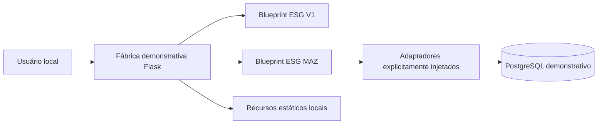

# RECIC3 ESG-MAZ — escopo demonstrativo congelado

Baseline funcional: ESG-MAZ-05C, revalidada visualmente por pessoa responsável na ESG-MAZ-05D em 26/11/2026. Marco de apresentação: 08/12/2026. RF-1A permanece **NO-GO OPERACIONAL**. A apresentação é uma etapa intermediária da implantação permanente no RECIC3.

O congelamento abrange a candidata sobre `29b9da6ad29bdcc5ea7f7867064a59935d2a7e02`, branch `feat/recic3-esg-fgv-pitch`. Não autoriza commit, publicação ou produção. O inventário e os SHA-256 exatos estão no pacote externo ESG-MAZ-06A. Nenhum comportamento da aplicação é alterado nesta etapa; os únicos novos arquivos versionáveis são estes documentos.

## Funcionalidades incluídas

- Aplicação local isolada com autenticação sintética, autorização administrativa, sessão e CSRF; blueprint aditivo com adaptadores explicitamente injetados.
- Painel Estratégico — Marechal Aterro Zero, dimensões Ambiental/Social/Governança, seleção explícita de série, situações dos casos, disponibilidade e G2.
- Catálogo dos 16 códigos, pesquisa, filtros, metadados metodológicos disponíveis e destaque de K01. A1 é alias de K01, sem medição paralela.
- Cadastro/recuperação de TRCS, unidades originais kg/t independentes, evidências, fontes versionadas, histórico e revisão por CAS com auditoria na mesma transação.
- Acompanhamento documental de obrigações: competência, instrumento, prazo, responsáveis proposto/designado, documentos/manifestações, pendências, riscos, encaminhamentos e revisões.
- G2 calculado sobre a revisão consultada, distinguindo preenchido, explicitamente indisponível e não informado.
- Dupla materialidade conceitual com cinco temas candidatos. Sem pontuações, pesos, prioridades homologadas ou participação simulada.
- CSS, JavaScript de prévia e favicon locais. Não há CDN nem série histórica fabricada.

Novas funcionalidades ou alterações após o congelamento exigem reprodução da necessidade, avaliação de impacto, regressão pertinente e nova validação do que afetar a apresentação. Falhas materiais não devem ser ocultadas com expansão de escopo.

## Catálogo e regras metodológicas

As definições completas, fontes esperadas, limitações e impedimentos permanecem em [`catalogo.py`](catalogo.py) e [`METODOLOGIA.md`](METODOLOGIA.md). Esta tabela identifica a versão congelada; não substitui esses contratos nem atribui periodicidades ausentes.

| Código | Nome no catálogo | Dimensão proposta |
|---|---|---|
| K01 | TRCS | Ambiental |
| K02 | Destinações e redução de aterramento | Ambiental |
| K03 | Orgânicos e IDO | Ambiental |
| K04a | Triagem | Ambiental |
| K04b | Expedição e aceite | Ambiental |
| K04c | Margem operacional por kg aceito | Governança |
| K05 | Completude | Governança |
| K06 | Tempestividade | Governança |
| K07 | Divergência física | Governança |
| K08 | Custos e financiamento | Governança |
| K09a | Inclusão social — subcódigo a confirmar | Social |
| K09b | Inclusão social — subcódigo a confirmar | Social |
| K09c | Inclusão social — subcódigo a confirmar | Social |
| K09d | Inclusão social — subcódigo a confirmar | Social |
| K10 | CDR | Ambiental |
| K11 | Gravimetria | Ambiental |

Somente K01 tem motor implementado neste recorte. A TRCS bruta é `100 × rejeitos expedidos / entrada comparável`, com normalização exata de kg/t e preservação da razão exata. Ausência é diferente de zero; entrada zero não gera percentual. Reconciliação física, qualidade documental e autorização institucional são dimensões separadas. A diferença entre entrada e rejeitos não comprova recuperação. Percentuais com duas casas são apenas apresentação; a prévia JavaScript é aproximada e não substitui o servidor.

G2 considera 13 campos. Completude efetiva é `preenchidos/13`; campos tratados são `(preenchidos + explicitamente indisponíveis)/13`. Nenhuma dessas proporções determina cumprimento jurídico ou autorização operacional. Competência pode ser mensal, anual ou explicitamente indisponível. Não há prazo ou responsável formal presumido.

## Arquitetura e coexistência



`app.py` não é modificado nem importado para iniciar a fábrica demonstrativa. A autenticação sintética não substitui o controle institucional do RECIC3. O executor externo valida cluster, identidade, conta, destino, permissões de arquivo, hashes e encerramento; não faz descoberta automática de banco. A migração operacional dessa arquitetura é tratada no [roteiro definitivo](ROTEIRO_OPERACIONAL.md).

O ESG V1 mantém `/esg` disponível com aviso de configuração. Consultas/cadastros persistentes de V1, como `/esg/indicadores`, retornam 503 sem repositório injetado. Esse resultado esperado não é falha do MAZ nem integração operacional concluída.

## Rotas congeladas

| Método | Rota | Finalidade |
|---|---|---|
| GET/POST | `/login` | Autenticação sintética local |
| POST | `/logout`, `/sair` | Encerrar sessão com CSRF |
| GET | `/esg/maz/` | Painel; parâmetros `escopo` e `serie` |
| GET | `/esg/maz/catalogo` | Pesquisa `q`, `dimensao`, `disponibilidade` |
| GET | `/esg/maz/materialidade` | Temas candidatos e duas perspectivas |
| GET | `/esg/maz/trcs` | Séries; `escopo`, `q`, `competencia` |
| GET/POST | `/esg/maz/trcs/nova` | Cadastro sintético |
| GET | `/esg/maz/trcs/<UUID>` | Ficha da revisão |
| GET/POST | `/esg/maz/trcs/<UUID>/revisar` | Nova revisão somente a partir da corrente |
| GET | `/esg/maz/obrigacoes` | Casos; `escopo`, `q`, `situacao` |
| GET/POST | `/esg/maz/obrigacoes/nova` | Novo caso sintético |
| GET | `/esg/maz/obrigacoes/<identificador>` | Ficha corrente |
| GET | `/esg/maz/obrigacoes/<identificador>/revisoes/<UUID>` | Ficha histórica |
| GET/POST | `/esg/maz/obrigacoes/<identificador>/revisar` | Nova revisão com CAS |
| GET | `/esg/maz/assets/<recurso>` | CSS, JavaScript e favicon locais |

Uma revisão TRCS desatualizada ou divergência entre rota e UUID esperado recebe 409. A restrição visual não substitui o CAS no adaptador. Confirmação incerta recebe 503 sem repetição automática. Evidências novas podem ter fonte própria; fontes/documentos históricos não são reescritos.

## Casos sintéticos congelados e evidência humana

| Caso | Revisão | Resultado confirmado |
|---|---|---|
| TRCS, 2055-11, Homologação visual - UVR teste | 1, histórica | Entrada 1000 kg; rejeitos 250 kg; 25% |
| Mesma série TRCS | 2, vigente | Entrada 1000 kg; rejeitos 200 kg; 20% |
| O14-demo | 2, histórica | G2 7/13 = 53,85%; 2 documentos; responsável proposto indisponível |
| O14-demo | 3, vigente | G2 8/13 = 61,54%; 3 documentos; Equipe técnica ambiental [SINTÉTICO]; HV-OBR-001 |

A aprovação visual humana das sete correções, painel, catálogo, séries, obrigações e materialidade foi informada pelo solicitante em ESG-MAZ-06A. A execução `run_20261126T230747Z` confirmou `passed`, `errors=[]`, preservação e shutdown. O executor comprova seu ciclo de vida; a avaliação visual é a declaração humana, não uma conclusão inferida do status automatizado.

O caso-base anterior usa `demo05a-recorte`. A seleção principal inclui esse perímetro, a série humana explicitamente ancorada e O14-demo. `escopo=todos` permite consultar os ensaios. Os casos sintéticos não representam os 15 itens reais do Plano Executivo.

## Validação e requisitos

Ambiente efetivamente homologado: Windows, CPython 3.12.10, PostgreSQL 17.0, Flask 3.1.2 e dependências pinadas. O comentário de `requirements.txt` e `.python-version` referem 3.12.6; o inventário do executor registra a versão realmente ensaiada, 3.12.10. Não se afirma equivalência sem ensaio. Dependências e preparação de notebook estão no [plano de portabilidade](PORTABILIDADE_WINDOWS.md).

A matriz externa 06A identifica cada teste e sua origem: 165 Windows, 41 do adaptador, 24 de obrigações e 38 web/PostgreSQL, com contagem por ID e distinção entre execução nova e evidência reaproveitada. Os 38 web da candidata 05C são reaproveitados por correspondência dos hashes; as escritas novas do adaptador/obrigações usam o banco sintético de ensaios separado do cenário demonstrativo. A conferência integrada 06A do cenário é somente de leitura, incluindo autenticação/CSRF sem gravação no banco. Consultar os resultados finais do pacote, sem somar repetições como testes novos.

Resultado 06A: 230 testes das suítes anteriores executados e aprovados (165 + 41 + 24), dez verificações integradas adicionais aprovadas e 38 testes web reaproveitados da mesma candidata. São 240 execuções efetivas e 278 identificadores distintos cobertos entre execução e reaproveitamento, sem sobreposição de IDs; oito POSIX permanecem pendentes. Zero falhas, erros ou skips nas execuções finais. O banco demonstrativo permaneceu exatamente igual e o ledger continuou com 30 entradas. O HTTP 503 esperado de V1 sem persistência foi confirmado como limitação de configuração.

Os oito testes de `tests/test_esg_pitch.py` continuam pendentes em POSIX. São testes de fixture/executivo, não do motor TRCS nem da interface MAZ. O arquivo exige contêiner isolado autorizado antes dos imports. A presença de `wsl.exe`/`bash.exe` no Windows não comprova ambiente disponível/autorizado; não houve ativação de WSL, Docker, instalação ou acesso externo. Essa pendência limita a cobertura da entrega Windows e deve ser resolvida no ambiente alvo antes de homologação operacional. Os testes de exportação não rastreados ficam fora do checkpoint da interface.

## Inicialização e encerramento no desktop homologado

Os caminhos abaixo identificam artefatos locais já existentes. Não são requisitos permanentes de uma distribuição para notebook.

```powershell
$checkpoint = Join-Path $env:LOCALAPPDATA 'Temp\RECIC3_ESG_MAZ05C_20261126'
$python = Join-Path $env:LOCALAPPDATA 'Temp\RECIC3_ESG_MAZ01_20261124_ae2a1340\venv\Scripts\python.exe'
& $python -I -S -B (Join-Path $checkpoint 'demo_lifecycle.py') serve
```

Após `DEMO_READY`, abrir `http://127.0.0.1:5055/login`. O código sintético permanece protegido no diretório `secrets` do cluster; não copiar para documentação, Git ou pacote. Sessão/chave são renovadas a cada inicialização. O executor verifica os hashes e exige o cluster inicialmente encerrado.

Em outra janela PowerShell:

```powershell
$checkpoint = Join-Path $env:LOCALAPPDATA 'Temp\RECIC3_ESG_MAZ05C_20261126'
[IO.File]::WriteAllText((Join-Path $checkpoint 'STOP_DEMO'),'encerrar demonstracao')
```

Aguardar `status=passed` e shutdown confirmado no último `results.json`; verificar ausência de listeners em 5055 e 65437 e de `postmaster.pid`. Não usar kill genérico ou outro PGDATA. O PostgreSQL permitido é exclusivamente o cluster descartável identificado pelo executor em `127.0.0.1:65437`. Não iniciar o modo de testes web para apresentar o cenário: ele acrescenta ensaios sintéticos. A versão 06A de homologação não é o inicializador da apresentação.

## Limitações e riscos residuais

- RF-1A: NO-GO OPERACIONAL. Sem dados municipais, autenticação institucional, automação de pesagens, integração documental operacional, alertas ou novos motores.
- Nenhuma aprovação/publicação automática. Fontes e documentos não recebem autenticidade ou eficácia jurídica presumida.
- Imutabilidade de linhas não significa fechamento integral do grafo documental.
- M0017/M0018/M0019 e seus checksums são preservados. O manifesto operacional não foi promovido. A cadeia candidata só foi ensaiada em ambiente descartável; compatibilidade com banco preexistente requer ensaio específico.
- Listagens recuperam revisões individualmente e não têm paginação; revisar desempenho antes de escala operacional.
- O instalador portátil e a operação sem internet no notebook ainda exigem preparação e ensaio próprio. Não copiar PGDATA nem credenciais do desktop.
- Os arquivos antigos com caminhos locais e o executor externo servem ao checkpoint do desktop. A distribuição futura deve parametrizar caminhos, gerar credenciais localmente e homologar sua própria cadeia de startup/shutdown.
